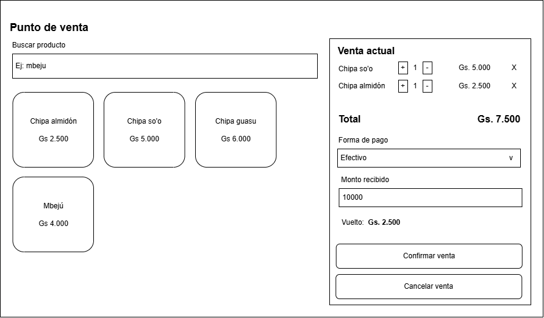

# Respuestas — Ejercitario Unidad 05

> Completen cada pregunta debajo de su enunciado. Pueden borrar este bloque de instrucciones una vez que empiecen.
> Las imágenes (diagramas, capturas, wireframes) se suben a esta misma carpeta y se enlazan así: ``

---

## Tema 1 · El diseño en la ingeniería de software

**1. Explica con tus palabras la diferencia entre diseño conceptual y diseño técnico (detallado). Da un ejemplo de una decisión de cada tipo para un sistema de gestión de una biblioteca.**

_Respuesta: El diseño conceptual define qué debe hacer el sistema y cómo se organiza la información, mientras que el diseño técnico define cómo se implementará en detalle usando tecnologías, estructuras y componentes específicos.
 Ejemplo de decisiones para un sistema de gestión de biblioteca
 Ejemplo de decisión de diseño conceptual
Definir que un “Libro” es una entidad con título, autor, categoría y estado de disponibilidad, y que un “Usuario” puede realizar préstamos y devoluciones.
Esta decisión describe la estructura del sistema y sus reglas, sin mencionar bases de datos ni tecnologías.
 Ejemplo de decisión de diseño técnico (detallado)
Decidir que la tabla libros tendrá un índice en el campo titulo para acelerar las búsquedas, y que el sistema usará PostgreSQL como base de datos.
Aquí ya se especifican detalles concretos de implementación.

**2. Completa el siguiente cuadro sobre los elementos del modelo de diseño.**

| Elemento del diseño | ¿Qué define? | Ejemplo en un sistema de inscripciones |
|---|---|---|
| Diseño de datos | Define la estructura lógica de la información, sus relaciones, reglas y restricciones. Incluye entidades, atributos, claves, integridad y cómo se almacenan y gestionan los datos. | Tablas como Estudiantes, Cursos, Inscripciones.Relaciones: un estudiante puede inscribirse en muchos cursos; un curso tiene muchos estudiantes.Restricciones: un curso no puede exceder su cupo máximo. |
| Diseño arquitectónico | Define la estructura global del sistema, sus módulos principales, capas, componentes y cómo se comunican. Es la vista de alto nivel del sistema. | Arquitectura en capas:Capa de presentación (web o móvil).Capa de lógica de negocio (gestión de inscripciones, validaciones).Capa de datos (base de datos relacional).Servicios: módulo de autenticación, módulo de gestión de cursos, módulo de reportes. |
| Diseño de interfaces | Define cómo interactúan los usuarios y los sistemas entre sí: pantallas, formularios, API, flujos de interacción, usabilidad y accesibilidad. | Pantalla de inicio de sesión.Formulario para inscribir un estudiante en un curso.Interfaz de consulta de cursos disponibles.API REST para que otra aplicación consulte inscripciones. |
| Diseño de componentes | Define la implementación interna de cada módulo, sus funciones, clases, métodos y cómo se organizan para cumplir la lógica del sistema. | Clase GestorInscripciones con métodos:inscribir(estudiante, curso)cancelarInscripcion(id)verInscripciones(estudiante)Componente de validación de cupos.Componente de generación de comprobantes. |

---

## Tema 2 · Conceptos fundamentales de diseño

**3. Ejercicio de relación** (completen con el número que corresponda a cada letra):

| Concepto | Número |
|---|---|
| A. Abstracción | __4_ |
| B. Refinamiento progresivo | __6_ |
| C. Ocultamiento de información | __2_ |
| D. Separación de intereses | __5_ |
| E. Patrón | __3_ |
| F. Refactorización | __1_ |

1. Mejorar la estructura interna sin cambiar el comportamiento externo.
2. Cada módulo esconde sus decisiones internas y solo expone su interfaz.
3. Solución probada a un problema de diseño que se repite en un contexto dado.
4. Concentrarse en lo esencial e ignorar los detalles irrelevantes en ese nivel.
5. Dividir un problema en partes que se puedan resolver y modificar de forma independiente.
6. Agregar detalle en pasos sucesivos, partiendo de una descripción general.

**4. Aplica refinamiento progresivo a la tarea "Registrar una venta en un comercio": escribí al menos tres niveles de detalle, refinando en el tercer nivel uno de los pasos del segundo.**

_Respuesta: El refinamiento progresivo descompone la tarea en niveles cada vez más detallados, y aquí se presentan tres niveles donde el tercero profundiza uno de los pasos del segundo.
A continuación se muestra una descomposición completa en tres niveles, con un refinamiento específico en el tercer nivel.
Nivel 1: Descripción general de la tarea
Este nivel resume la tarea en términos amplios, sin entrar en detalles operativos.
Registrar una venta en un comercio consiste en identificar los productos que el cliente desea comprar, calcular el total a pagar, recibir el pago y generar un comprobante de la transacción.
Este nivel establece el propósito global: transformar la intención de compra del cliente en una transacción registrada.
Nivel 2: Desglose en pasos principales
Aquí se detallan los componentes esenciales del proceso, manteniendo un nivel operativo pero aún general.
Identificar los productos o servicios adquiridos por el cliente.
Incluye verificar cantidades, precios y disponibilidad.
Calcular el monto total de la venta.
Se suman los precios, se aplican descuentos y se calculan impuestos.
Registrar la venta en el sistema del comercio.
Se ingresa la información en el software o libro de ventas.
Procesar el pago del cliente.
Se acepta efectivo, tarjeta u otro medio de pago y se confirma la operación.
Emitir el comprobante de la transacción.
Puede ser un ticket, factura o boleta, según el tipo de comercio y normativa.
Entregar los productos al cliente.
Se verifica que todo esté correcto y se finaliza la atención.
Nivel 3: Refinamiento de uno de los pasos del nivel 2
Se elige el paso 3: Registrar la venta en el sistema del comercio para refinarlo con mayor detalle.
Refinamiento del paso 3: Registrar la venta en el sistema
Abrir la interfaz de registro de ventas.
El empleado accede al módulo correspondiente en el sistema de punto de venta.
Ingresar los productos seleccionados.
Escanear códigos de barras,
Buscar productos manualmente,
Verificar que las cantidades coincidan con lo solicitado.
Confirmar precios y aplicar descuentos.
Revisar precios cargados automáticamente,
Aplicar promociones vigentes,
Validar descuentos especiales autorizados.
Verificar impuestos y totales.
El sistema calcula IVA u otros tributos; el empleado revisa que los montos sean correctos.
Guardar la venta en el sistema.
Se confirma la operación para que quede registrada en la base de datos del comercio.
Preparar la información para la emisión del comprobante.
El sistema genera los datos necesarios para imprimir o enviar el ticket o factura.

---

## Tema 3 · Descomposición y modularidad

**5. Explica por qué no conviene dividir un sistema ni en muy pocos ni en demasiados módulos. ¿Qué costos aumentan en cada extremo?**

_Respuesta: Un sistema con muy pocos módulos aumenta los costos de mantenimiento y comprensión, mientras que uno con demasiados módulos incrementa los costos de coordinación, comunicación y gestión de dependencias.
Módulos demasiado grandes (muy pocos)
Cuando el sistema se divide en muy pocos módulos, cada módulo termina abarcando demasiadas responsabilidades. Esto genera:
Baja cohesión: los elementos del módulo no pertenecen realmente juntos, lo que dificulta entender su propósito 
Alto acoplamiento interno: muchos elementos dependen entre sí, haciendo que un cambio afecte a múltiples partes del sistema 
Mantenibilidad reducida: localizar errores o modificar funcionalidades se vuelve más difícil porque el módulo es grande y heterogéneo.
Comprensión más compleja: el desarrollador debe cargar más información mental para entender cada módulo, aumentando el costo cognitivo 
Menor reutilización: módulos grandes y poco específicos son difíciles de reutilizar en otros sistemas 

En resumen, aumentan los costos de mantenimiento, comprensión y evolución del sistema.

**6. Para un sistema de gestión de un consultorio médico, propone dos descomposiciones distintas e indica qué módulos tendría cada una.**

| Estrategia | Módulos propuestos |
|---|---|
| Por capas | Presentación (Interfaz web/móvil para médicos y pacientes), Lógica de negocio (Gestión de turnos, validación de historias clínicas y reglas de atención), y Acceso a datos (Consultas y transacciones con la base de datos de pacientes, médicos y recetas) |
| Por dominio | Módulo de Pacientes (admisión e historia clínica), Módulo de Citas/Agendamiento (gestión de turnos y agendas médicas), Módulo de Facturación (cobros, obras sociales y pagos), y Módulo de Farmacia/Recetas (emisión de recetas y control de medicamentos). |

---

## Tema 4 · Cohesión y acoplamiento

**7. Indica el tipo de cohesión de cada módulo (coincidental, lógica, temporal, procedimental, comunicacional, secuencial o funcional) y justifica brevemente.**

| Módulo | Tipo de cohesión y justificación |
|---|---|
| a) "Utilidades": FormatearFecha, EnviarCorreo y CalcularIVA. | Coincidental: Agrupa tareas sin relación entre sí por mera casualidad. |
| b) "IniciarSistema": abre la conexión a la base, carga la configuración y borra archivos temporales. | Temporal: Las tareas están agrupadas únicamente porque ocurren en el mismo momento (durante el arranque). |
| c) "CalcularPromedioAlumno": obtiene las notas de un alumno y devuelve su promedio. | Funcional: Todas las partes del módulo contribuyen a una única tarea bien definida. |
| d) "ProcesarOperacion": recibe un código y, según su valor, imprime, guarda o elimina un registro. | Lógica: Agrupa elementos lógicamente relacionados donde la ejecución de uno u otro es seleccionada por un parámetro o selector interno. |
| e) Lee un registro, lo valida y, con el registro ya validado, calcula su total. | Secuencial: Las salidas o datos procesados en un paso sirven como entrada para el siguiente paso dentro de una secuencia lógica. |

**8. Indica el tipo de acoplamiento en cada caso (de datos, por estampado, de control, externo, común o de contenido).**

| Situación | Tipo de acoplamiento |
|---|---|
| a) El módulo A llama a B pasándole solo el idAlumno. | De datos: Se pasan únicamente los datos necesarios como parámetros simples. |
| b) A le pasa a B una bandera modo = "imprimir" / "guardar" que decide qué hace B. | De control: Un módulo le pasa a otro un indicador o bandera que controla el flujo y la lógica interna del receptor. |
| c) Varios módulos leen y modifican la variable global TotalVentas. | Común: Múltiples módulos comparten y dependen de un mismo bloque de datos globales. |
| d) A modifica directamente un atributo privado de B. | De contenido: Un módulo accede o modifica directamente los datos internos de otro, violando el ocultamiento de información. |
| e) A le pasa a B el objeto Alumno completo, aunque B solo usa la fecha de nacimiento. | Por estampado: Se pasa una estructura de datos completa (objeto compuesto) aunque el módulo receptor solo utilice una porción de ella. |

**9. Explica por qué la alta cohesión y el bajo acoplamiento suelen ir de la mano. Da un ejemplo.**

_Respuesta:_

La alta cohesión implica que un módulo se enfoca en una única responsabilidad bien definida. Al estar tan enfocado y autocontenido, necesita intercambiar poca información con el exterior y requiere mínimos detalles de otros componentes, lo que de forma natural reduce sus dependencias (bajo acoplamiento). Por el contrario, un módulo mal cohesionado que mezcla múltiples tareas dispersas inevitablemente requerirá múltiples datos y llamadas externas, elevando su acoplamiento.
Ejemplo: Un módulo funcional dedicado exclusivamente a ValidarMatriculaMedico solo necesita recibir el número de matrícula y consultar la base de datos de forma directa y limpia (alta cohesión y bajo acoplamiento). Si el mismo módulo se encargara además de cobrar la consulta, enviar correos y actualizar el inventario (baja cohesión), se vería obligado a acoplarse con múltiples subsistemas y variables globales de la aplicación.

---

## Tema 5 · Arquitectura y estilos arquitectónicos clásicos

**10. Ejercicio de relación** (completen con el número que corresponda a cada letra):

| Estilo arquitectónico | Número |
|---|---|
| A. En capas | 5 |
| B. Cliente-servidor | 4 |
| C. Centrado en datos (repositorio) | 2 |
| D. Tuberías y filtros | 1 |
| E. Modelo-Vista-Controlador | 3 |

1. Un compilador: análisis léxico → sintáctico → semántico → generación de código.
2. Un entorno de desarrollo donde editor, depurador y analizador comparten un modelo central del proyecto.
3. Una aplicación web donde un controlador recibe el pedido, actualiza el modelo y elige qué vista mostrar.
4. Un cajero automático que consulta al servidor del banco para cada operación.
5. Un sistema contable organizado en presentación, lógica de negocio y acceso a datos.

**11. Dibujá o describí la arquitectura en capas de un sistema que conozcas (de tu trabajo, de la universidad o una app de uso diario), indicando la responsabilidad de cada capa. Si lo dibujan, agreguen la imagen al repositorio y enlácenla en la respuesta.**
Sistema elegido: sistema de reservación de hoteles en la web (tipo Trivago).

Presentación	Mostrar la información al usuario (búsqueda de hoteles, detalle de habitaciones, formulario de reserva) y recibir sus acciones. No contiene reglas de negocio ni accede directo a la base de datos.

Lógica de negocio	Aplicar las reglas del sistema: verificar que la habitación esté disponible en las fechas pedidas, calcular el precio total, impedir reservas superpuestas y confirmar la reserva.

Acceso a datos	Ejecutar las consultas y transacciones necesarias (guardar una reserva, buscar habitaciones libres), ocultando a la capa de negocio los detalles de la base de datos.

Base de datos	Almacenar de forma persistente los hoteles, habitaciones, clientes y reservas.

Reglas del estilo: cada capa solo usa la capa inmediatamente inferior. Si se cambia el motor de base de datos, solo se modifica el acceso a datos. Si se agrega una app móvil, se reutiliza la lógica de negocio existente.

---

## Tema 6 · Estilos actuales y estrategia de selección

**12. Completa el siguiente cuadro comparativo.**

| Aspecto | Monolito modular | Microservicios |
|---|---|---|
| Despliegue | Una sola unidad: simple de publicar. | Cada servicio se despliega por separado: requiere automatización. |
| Escalado |Se escala la aplicación completa.  |  Se escala solo el servicio que lo necesita.|
| Complejidad operativa | Baja. | Alta: red, monitoreo, trazas y fallos parciales. |
| ¿Cuándo conviene? | Equipos chicos y dominio aún cambiante. | Equipos grandes y autónomos, o partes con cargas muy distintas. |

**13. Una empresa nueva con tres desarrolladores quiere empezar su producto directamente con quince microservicios. ¿Qué le recomendarías y por qué?**

1. Complejidad operativa desproporcionada. Quince servicios implican quince despliegues, monitoreo, trazas y manejo de fallos parciales de red. Tres desarrolladores gastarían más tiempo en infraestructura que en el producto.
   
2. El dominio todavía está cambiando. En una empresa nueva los límites del negocio se descubren con el tiempo. Si se separan mal los servicios, corregirlo es caro porque hay que mover datos y contratos entre servicios.
   
3. Consistencia de datos. Con una base por servicio, las transacciones simples pasan a ser un problema difícil. En un monolito hay una sola base y transacciones simples.
   
4. Escala real inexistente. Los microservicios se justifican cuando hay equipos grandes y autónomos o partes con cargas muy distintas, y ninguna de esas condiciones se da aquí.

Recomendación concreta: un monolito dividido en módulos con límites claros (alta cohesión y bajo acoplamiento, organizados por dominio). Más adelante, si un módulo necesita escalar de forma independiente o el equipo crece, ese módulo puede extraerse como microservicio. Esto aplica el principio KISS: la solución más simple que resuelve el problema suele ser la mejor.

**14. Para cada escenario, indica el atributo de calidad prioritario y un estilo arquitectónico que lo favorezca.**

| Escenario | Atributo prioritario | Estilo que lo favorece |
|---|---|---|
| Plataforma de venta de entradas con picos enormes de demanda al abrir la venta. | Escalabilidad (junto con disponibilidad) | Microservicios o arquitectura orientada a eventos, con componentes sin estado que se escalan por separado (por ejemplo, el servicio de compra). |
| Sistema bancario de transferencias entre cuentas. | Seguridad (junto con confiabilidad y consistencia de datos) | Arquitectura en capas, con controles en los bordes y mínima superficie expuesta, sobre una base de datos transaccional única. |
| Sistema académico cuyas reglas de inscripción cambian cada semestre. | Mantenibilidad | Arquitectura en capas o monolito modular, con la lógica de negocio aislada en su propia capa o módulo, de alta cohesión y bajo acoplamiento, para cambiar las reglas sin tocar el resto. |

---

## Tema 7 · Características de un buen diseño

**15. Menciona las tres directrices de calidad de Pressman para un buen diseño y explica una de ellas con un ejemplo propio.**
Según Pressman, un buen diseño debe cumplir como mínimo estas tres condiciones:

1. Implementar los requerimientos. Debe satisfacer todos los requerimientos explícitos del modelo de requerimientos y también los implícitos que el cliente espera.
   
2. Ser legible y comprensible. Debe poder ser entendido por quienes van a construirlo, probarlo y mantenerlo.

3. Dar una visión completa. Debe describir los datos, las funciones y el comportamiento desde la perspectiva de la implementación.

Explicación de una directriz con un ejemplo propio: “Implementar los requerimientos”

Esta directriz exige que el diseño cubra todo lo que el sistema debe hacer, incluso lo que el cliente no escribió pero da por hecho.

Ejemplo: en un sistema web de reservación de hoteles, el requerimiento explícito es “el usuario puede reservar una habitación para unas fechas”. El diseño debe cubrir eso, pero también los requerimientos implícitos: que el sistema no permita reservar dos veces la misma habitación en las mismas fechas, que los datos de pago viajen de forma segura y que el usuario reciba una confirmación. Si el diseño solo contempla el formulario de reserva y omite la verificación de disponibilidad, aunque nadie la haya pedido por escrito, no cumple la directriz.

**16. Ejercicio de relación** (completen con el número que corresponda a cada letra):

| A. Rigidez | 3 |
| B. Fragilidad | 4 |
| C. Inmovilidad | 2 |
| D. Repetición innecesaria | 1 |

1. La misma lógica está copiada en varios lugares del sistema.
2. Cuesta reutilizar un componente porque arrastra demasiadas dependencias.
3. Un cambio simple obliga a modificar muchos módulos.
4. Un cambio rompe partes que aparentemente no tenían relación.

---

## Tema 8 · Principios SOLID

**17. Completa el cuadro con el nombre de cada principio y lo que propone, en una oración.**
| S | Single Responsibility - Responsabilidad Única | Una clase debe tener una sola razón para cambiar, una sola responsabilidad. |
| O | Open/Closed - Abierto/Cerrado | El software debe estar abierto a extensión pero cerrado a modificación. |
| L | Liskov Substitution - Sustitución de Liskov | Las clases hijas deben poder sustituir a su clase padre sin romper el sistema. |
| I | Interface Segregation - Segregación de Interfaces | Es mejor tener muchas interfaces específicas que una sola interfaz general y gigante. |
| D | Dependency Inversion - Inversión de Dependencias | Depender de abstracciones (interfaces), no de clases concretas. |

**18. Analiza la siguiente clase: "ReporteVentas obtiene las ventas desde SQL Server, calcula los totales, arma un PDF y lo envía por correo". ¿Qué principio SOLID viola principalmente? Propone una mejor distribución de responsabilidades (nombres de clases o interfaces y qué hace cada una).**

_Respuesta:_
Principio que viola:** S - Single Responsibility Principle (Responsabilidad Única).

**Por qué:** La clase `ReporteVentas` tiene 4 responsabilidades distintas:
1. Acceso a datos (obtiene ventas desde SQL Server)
2. Lógica de negocio (calcula totales)
3. Presentación (arma un PDF)
4. Infraestructura/Comunicación (envía por correo)

Si cambia la base de datos, si cambia el formato del PDF, si cambia el cálculo o si cambia el proveedor de correo, hay que modificar la misma clase. Eso genera Rigidez y Fragilidad.

**Propuesta de mejor distribución:**

| Clase / Interfaz | Responsabilidad |
|---|---|
| `IVentaRepository` / `VentaRepositorySQL` | Solo obtiene las ventas de SQL Server. |
| `CalculadoraTotalesVentas` | Solo calcula los totales y estadísticas de las ventas. |
| `IGeneradorReporte` / `GeneradorPDFVentas` | Solo toma los datos calculados y arma el PDF. |
| `IEnviadorCorreo` / `ServicioEmail` | Solo envía el archivo por correo. |
| `ServicioReporteVentas` | Clase orquestadora que coordina: pide datos -> calcula -> genera PDF -> envía. No hace el trabajo, solo coordina. |

Así cada clase tiene una sola razón para cambiar y se pueden reutilizar y probar por separado.

## Tema 9 · Evaluación y validación del diseño

**19. Explica la diferencia entre una revisión técnica del diseño y una prueba del software. ¿Por qué conviene revisar el diseño antes de programar?**

_Respuesta:_

**Revisión técnica del diseño:** Es una verificación ESTÁTICA, sin ejecutar código. Se revisan documentos (analisis.md, diagramas, casos de uso) para encontrar errores, incoherencias o reglas de negocio mal definidas. Se hace entre personas. Es preventiva.

**Prueba del software:** Es una verificación DINÁMICA, ejecutando el código. Se prueba el programa ya hecho para ver si hace lo que debe y si falla. Se hace con casos de prueba, datos de entrada y salida. Es correctiva.

**¿Por qué conviene revisar el diseño antes de programar?**

Porque corregir un error en un documento cuesta 1 hora, pero corregir ese mismo error ya programado cuesta 10 o 100 veces más. Si el diseño está mal (ej: RN-04 mal definida), se programa mal, se prueba mal y se entrega mal. Revisar antes evita:

1.  Re-trabajo de programación.
2.  Horneadas, devoluciones y pedidos mal registrados que afectan stock y caja.
3.  Discusiones con el cliente después.
Es mucho más barato prevenir que corregir.

**20. Completa la matriz de trazabilidad para un sistema de biblioteca, indicando qué elementos de diseño (módulos, clases, interfaces, pantallas) satisfacen cada requerimiento.**
| Req. | Descripción | Elementos de diseño que lo satisfacen |
|---|---|---|
| RF-01 | Registrar el préstamo de un libro a un socio. | **Pantalla:** `PantallaRegistroPrestamo`   **Clases:** `Prestamo`, `Libro`, `Socio`, `PrestamoService`   **Módulo:** `ModuloPrestamos` |
| RF-02 | Avisar por correo al socio cuando vence un préstamo. | **Interfaces:** `IEnviadorCorreo`, `IProgramadorTareas`   **Clases:** `ServicioNotificacionVencimiento`, `PlantillaEmail`, `EmailService`   **Módulo:** `ModuloNotificaciones` |
| RF-03 | Buscar libros por título, autor o tema. | **Pantalla:** `PantallaBusquedaLibros`   **Clases:** `BuscadorLibros`, `FiltroBusqueda`   **Interfaz:** `ILibroRepository`   **Módulo:** `ModuloCatalogo` |
| RNF-01 | Solo el personal de la biblioteca puede registrar préstamos. | **Pantalla:** `PantallaLogin`   **Clases:** `Usuario`, `Rol`, `AutenticacionService`, `AutorizacionService`   **Módulo:** `ModuloSeguridad` |

---

## Tema 10 · Diseño de la interfaz de usuario

**21. Para cada regla de oro, da un ejemplo de una aplicación o sitio que la cumpla y otro que la viole.**

| Regla de oro | Ejemplo que la cumple | Ejemplo que la viola |
|---|---|---|
| Dar el control al usuario | Gmail: después de enviar un correo aparece la opción "Deshacer", y se puede cancelar el envío. | Un formulario de inscripción que no tiene botón para volver atrás ni cancelar, y obliga a completar todo de nuevo si uno se equivoca. |
| Reducir la carga de memoria | Google: sugiere búsquedas mientras se escribe y recuerda las búsquedas recientes, así no hay que acordarse de todo. | Un sitio que pide anotar un código en una pantalla y escribirlo de memoria en la siguiente, sin mostrarlo de nuevo. |
| Lograr una interfaz consistente | Microsoft Office: los íconos, menús y atajos (guardar, copiar, pegar) funcionan igual en Word, Excel y PowerPoint. | Un sitio donde cada pantalla tiene los botones en lugares distintos, con colores y nombres diferentes para la misma acción (a veces "Aceptar", a veces "Guardar", a veces "OK"). |

**22. Realiza el análisis previo al diseño de la interfaz para la aplicación de autogestión de alumnos de la universidad.**

| Aspecto | Descripción |
|---|---|
| Usuarios | Estudiantes de la universidad, en su mayoría jóvenes y adultos de entre 18 y 40 años, de distintas carreras. Tienen experiencia media con la tecnología, ya que usan redes sociales y el celular todos los días, pero no son expertos en sistemas. Algunos trabajan y entran solo de a ratos. |
| Tareas principales | Inscribirse a materias y a exámenes, consultar notas e historial académico, ver horarios y aulas, revisar el estado de las cuotas y pagos, y pedir constancias o certificados. La inscripción y la consulta de notas son las más frecuentes. |
| Entorno de uso | Principalmente desde el celular (en el colectivo, en el trabajo, en la universidad) y también desde una computadora en casa. A veces con mala conexión a internet. En épocas de inscripción entra mucha gente al mismo tiempo, así que la interfaz tiene que ser rápida y liviana. |

---

## Tema 11 · Usabilidad, accesibilidad y prototipos

**23. Evaluación heurística: elijan una pantalla real (de un sitio web o una app que usen), agreguen una captura al repositorio e identifiquen al menos tres problemas de usabilidad o accesibilidad.**

Pantalla elegida: pantalla de inicio de sesión de Instagram (versión web, modo oscuro).

| Problema detectado | Heurística de Nielsen violada | Mejora propuesta |
|---|---|---|
| Al ingresar datos incorrectos, el mensaje dice solamente que "la información de inicio de sesión es incorrecta". No aclara si el error está en el usuario o en la contraseña, y ningún campo se marca como el que falló. | Ayudar a reconocer y recuperarse de errores. | Indicar cuál dato es el incorrecto, marcando ese campo, y mantener el enlace de recuperación junto al mensaje. |
| Los textos de las etiquetas de los campos y los enlaces del pie de página son pequeños y de color gris sobre fondo oscuro, por lo que cuesta leerlos. | Diseño estético y minimalista (y accesibilidad: contraste suficiente y tamaño de texto). | Aumentar el tamaño de la letra y usar un gris más claro para mejorar el contraste con el fondo. |
| La mitad izquierda de la pantalla está ocupada por una ilustración y un eslogan que no ayudan a la tarea de iniciar sesión, y compiten con el formulario. | Diseño estético y minimalista. | Reducir ese espacio o llevarlo a un segundo plano para que el formulario sea lo principal. |

**24. Elijan una pantalla clave del sistema de su Trabajo Práctico y dibujen su wireframe (puede ser la foto de un boceto en papel, agregada al repositorio). Indiquen qué regla de oro o heurística tuvieron en cuenta en al menos dos decisiones.**

_Respuesta:_

Pantalla elegida: Punto de Venta (POS) del cajero.

Decisiones tomadas:

1. **Reconocer antes que recordar (Heurística #6) / reducir la carga de memoria (regla de oro):** cada producto aparece como un botón con su stock visible, así el cajero no tiene que acordarse cuántas chipas quedan. El producto sin stock aparece marcado para que no se venda por error.
2. **Control y libertad del usuario (Heurística #3):** cada ítem de la venta tiene una "x" para quitarlo y siempre está disponible el botón "Cancelar", por si el cajero se equivoca durante la atención.
3. **Visibilidad del estado del sistema (Heurística #1):** el total y el vuelto se calculan y se muestran al instante, para evitar errores de cálculo en las horas de mayor clientela.

**25. Reflexión final: ¿qué estilo arquitectónico proponen para el sistema de su Trabajo Práctico y por qué? Justifiquen la elección con al menos dos atributos de calidad del sistema.**

_Respuesta:_

Proponemos un **monolito modular con arquitectura en capas** (presentación, lógica de negocio, acceso a datos y base de datos). El frontend en JavaScript con Bootstrap se comunica con el backend en Java (Spring Boot) por medio de una API REST. El backend se divide en módulos por dominio: caja, producción y stock, canasteros y reportes.

Lo elegimos por los siguientes atributos de calidad:

- **Mantenibilidad:** el equipo es chico (cinco personas) y el negocio puede pedir cambios en el futuro. Con capas y módulos de alta cohesión y bajo acoplamiento, un cambio (por ejemplo, en cómo se calcula la rendición de un canastero) se hace en un solo lugar sin romper el resto.
- **Confiabilidad y consistencia de los datos:** el sistema maneja dinero y stock, y no puede haber descuadres. Una única base de datos PostgreSQL permite transacciones simples, de modo que una venta descuenta el stock y registra el ingreso a la vez, o no se hace ninguna de las dos cosas.
- **Usabilidad:** el personal tiene poca experiencia con computadoras, así que separar la presentación de la lógica permite mejorar las pantallas y probarlas con los usuarios sin tocar las reglas del negocio.

No usamos microservicios porque el sistema se usa en una sola chipería, no hay una carga que justifique escalar por partes, y con tres o cuatro desarrolladores sería una complejidad innecesaria (principio KISS).
