[← Volver al inicio](../../index.md)

# Entrega 2 · Análisis

> *Qué debe hacer el sistema, desde la perspectiva del negocio y del usuario.*

---

## 1. Requisitos funcionales

| ID | Requisito | Prioridad |
|---|---|---|
| RF-01 | [El sistema debe permitir...] | Alta |
| RF-02 | [El sistema debe permitir...] | Alta |
| RF-03 | [El sistema debe permitir...] | Media |
| RF-04 | [El sistema debe permitir...] | Baja |

---

## 2. Requisitos no funcionales

| ID | Requisito | Categoría |
|---|---|---|
| RNF-01 | [ej. El sistema debe responder en menos de 2s] | Rendimiento |
| RNF-02 | [ej. Las contraseñas deben almacenarse cifradas] | Seguridad |
| RNF-03 | [ej. La interfaz debe ser utilizable sin capacitación previa] | Usabilidad |

---

## 3. Modelo de casos de uso

**Actores:**

- **Usuario** (actor abstracto): generaliza a los tres actores siguientes; representa lo que tienen en común, que es iniciar sesión.
- **Cajero:** atiende el mostrador, maneja la caja, registra a los canasteros y los pedidos.
- **Maestro Chipero** (rol Producción): registra las horneadas.
- **Dueño:** consulta los reportes del negocio.
- El **Canastero** no es un actor: no usa el sistema, sus movimientos los registra el Cajero.

**Diagrama de casos de uso:**

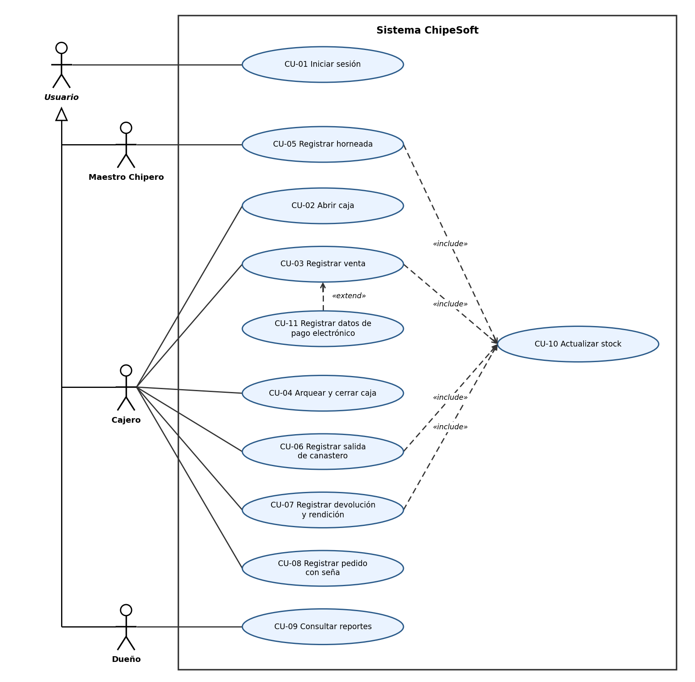

*Notación: las líneas continuas son asociaciones entre actores y casos de uso; la flecha con triángulo hueco es la generalización de actores; las flechas punteadas son relaciones «include» (el caso de uso de origen siempre usa a CU-10) y «extend» (CU-11 amplía a CU-03 solo cuando el pago no es en efectivo).*

**Resumen de casos de uso:**

| ID | Caso de uso | Actor | Requisito |
|---|---|---|---|
| CU-01 | Iniciar sesión | Usuario (Cajero, Maestro Chipero, Dueño) | RF-01 |
| CU-02 | Abrir caja | Cajero | RF-02 |
| CU-03 | Registrar venta | Cajero | RF-04 |
| CU-04 | Arquear y cerrar caja | Cajero | RF-03 |
| CU-05 | Registrar horneada | Maestro Chipero | RF-05 |
| CU-06 | Registrar salida de canastero | Cajero | RF-06 |
| CU-07 | Registrar devolución y rendición | Cajero | RF-07 |
| CU-08 | Registrar pedido con seña | Cajero | RF-08 |
| CU-09 | Consultar reportes | Dueño | RF-09 |
| CU-10 | Actualizar stock (incluido) | Sistema | RF-05 |
| CU-11 | Registrar datos de pago electrónico (extensión) | Cajero | RF-04 |

**Especificación de casos de uso principales:**

### CU-03 · Registrar venta

- **Actor(es):** Cajero
- **Precondición:** El Cajero inició sesión, existe una caja abierta y los productos a vender tienen stock.
- **Flujo principal:**
  1. El Cajero ingresa al Punto de Venta (POS).
  2. Selecciona un producto e indica la cantidad (repite este paso por cada producto).
  3. El sistema verifica el stock, muestra el subtotal de cada línea y el total de la venta.
  4. El Cajero elige la forma de pago: efectivo.
  5. El Cajero ingresa el monto recibido y el sistema calcula el vuelto.
  6. El Cajero confirma la venta.
  7. El sistema registra la venta en la caja abierta, actualiza el stock (CU-10) y emite el comprobante interno.
- **Flujos alternativos:**
  - *3a. Stock insuficiente:* el sistema informa las unidades disponibles y el Cajero corrige la cantidad o quita el producto.
  - *4a. Pago con tarjeta o transferencia:* se ejecuta CU-11 (el Cajero anota la referencia del pago) y el flujo continúa en el paso 6, sin cálculo de vuelto.
  - *5a. Monto recibido menor al total:* el sistema rechaza el monto y solicita uno válido.
  - *6a. El Cajero cancela la venta:* no se registra nada y el stock no cambia.
- **Postcondición:** La venta queda registrada en la caja abierta y el stock de los productos vendidos está descontado.

### CU-04 · Arquear y cerrar caja

- **Actor(es):** Cajero
- **Precondición:** El Cajero inició sesión y tiene una caja abierta.
- **Flujo principal:**
  1. El Cajero solicita el cierre de la caja.
  2. El sistema muestra el efectivo esperado (monto inicial más las ventas en efectivo y las rendiciones de canasteros).
  3. El Cajero cuenta el dinero e ingresa el efectivo contado.
  4. El sistema calcula la diferencia entre el efectivo contado y el esperado.
  5. El Cajero confirma el cierre.
  6. El sistema registra el arqueo, marca la caja como cerrada y muestra el resumen del día por forma de pago.
- **Flujos alternativos:**
  - *4a. La diferencia es distinta de cero:* el sistema solicita una observación obligatoria antes de permitir la confirmación.
  - *5a. El Cajero cancela el cierre:* la caja permanece abierta.
- **Postcondición:** La caja queda cerrada con su arqueo registrado y no admite nuevas ventas.

### CU-05 · Registrar horneada

- **Actor(es):** Maestro Chipero
- **Precondición:** El Maestro Chipero inició sesión con rol Producción.
- **Flujo principal:**
  1. El Maestro Chipero ingresa al módulo de Producción.
  2. Selecciona el producto que terminó de hornear.
  3. Ingresa la cantidad de unidades de la horneada.
  4. Confirma el registro.
  5. El sistema guarda la horneada con fecha, hora y usuario, y suma las unidades al stock (CU-10).
  6. El sistema muestra el stock actualizado del producto.
- **Flujos alternativos:**
  - *3a. Cantidad inválida (cero, negativa o no entera):* el sistema muestra un error y solicita corregirla.
  - *4a. El Maestro Chipero cancela:* no se registra nada.
- **Postcondición:** La horneada queda registrada y el stock del producto aumentó en la cantidad ingresada.

### CU-07 · Registrar devolución y rendición
| ID | Regla de Negocio |
|---|---|
| RN-01 | Un Canastero no puede tener más de una salida del día pendiente de rendición. |
| RN-02 | No se permiten cantidades inválidas: cero, negativas o no numéricas en horneada ni en entregas. |
| RN-03 | Si el Maestro Chipero cancela, la horneada no se registra en el sistema. |
| RN-04 | La cantidad devuelta por el Canastero no puede ser mayor a la cantidad entregada en su salida. |
| RN-05 | Si hay una caja abierta, no se puede abrir otra hasta cerrar la actual. |
| RN-06 | Si la diferencia entre lo rendido y lo vendido es distinta de cero, el sistema debe registrar la diferencia como faltante/sobrante. |
| RN-07 | Para registrar una devolución y rendición, el Canastero debe tener una salida pendiente y una caja abierta. |
| RN-08 | La fecha de entrega de un pedido con seña no puede ser anterior a la fecha actual. |
| RN-09 | La seña de un pedido no puede ser igual a cero ni mayor o igual al total del pedido. |
| RN-10 | El sistema debe sumar automáticamente las unidades devueltas al stock. |
| RN-11 | Toda horneada, salida, devolución y pedido debe quedar registrada con fecha, responsable y estado final. |
### CU-08 · Registrar pedido con seña

| Requisito | Caso de Uso |
|---|---|
| RF-01 | CU-07 - Registrar devolución y rendición |
| RF-02 | CU-08 - Registrar pedido con seña |
| RF-03 | CU-05 - Registrar horneada |

| Requisito No Funcional | Caso de Uso |
|---|---|
| RNF-01 | CU-07 - Tiempo de respuesta < 3 seg |
| RNF-02 | CU-08 - Validación de seña y datos |
---

## 4. Modelo de dominio

**Diagrama de clases conceptual:**

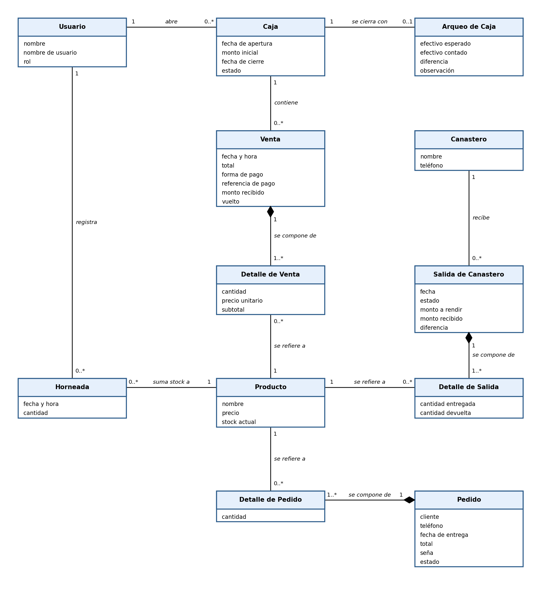

**Descripción de las entidades:**

- **Usuario:** persona que usa el sistema; su rol (Cajero, Dueño o Producción) define a qué módulos accede. Un Usuario abre Cajas (si es Cajero) y registra Horneadas (si es del área de Producción).
- **Caja:** turno de trabajo del Cajero, desde su apertura con un monto inicial hasta su cierre. Contiene las Ventas del turno y, al cerrarse, queda asociada a un **Arqueo de Caja**, donde se compara el efectivo contado con el esperado.
- **Venta / Detalle de Venta:** una Venta es la compra de un cliente en el mostrador (Punto de Venta) y se compone de una o más líneas, cada una referida a un Producto.
- **Producto:** tipo de chipa a la venta, con su precio y su stock actual. Es el eje del modelo: se vende, se hornea, se entrega a los canasteros y se pide para eventos.
- **Horneada:** lote de unidades de un Producto retirado del horno, que aumenta el stock.
- **Canastero / Salida de Canastero / Detalle de Salida:** el Canastero retira productos por la mañana y devuelve lo que no vendió por la tarde. La Salida guarda lo entregado y lo devuelto de cada Producto, y de ahí se calcula el monto a rendir.
- **Pedido / Detalle de Pedido:** reserva de productos de un cliente para una fecha futura, garantizada con una Seña.

---

## 5. Diagramas de comportamiento
Cada caso de uso principal tiene un diagrama: secuencia para CU-03, CU-05 y CU-08 (donde importa la interacción entre usuario y sistema) y actividad con calles (*swimlanes*) para CU-04 y CU-07 (donde hay decisiones y responsabilidades repartidas entre el Cajero y el Sistema).

### 5.1 Diagrama de secuencia · CU-03 Registrar venta

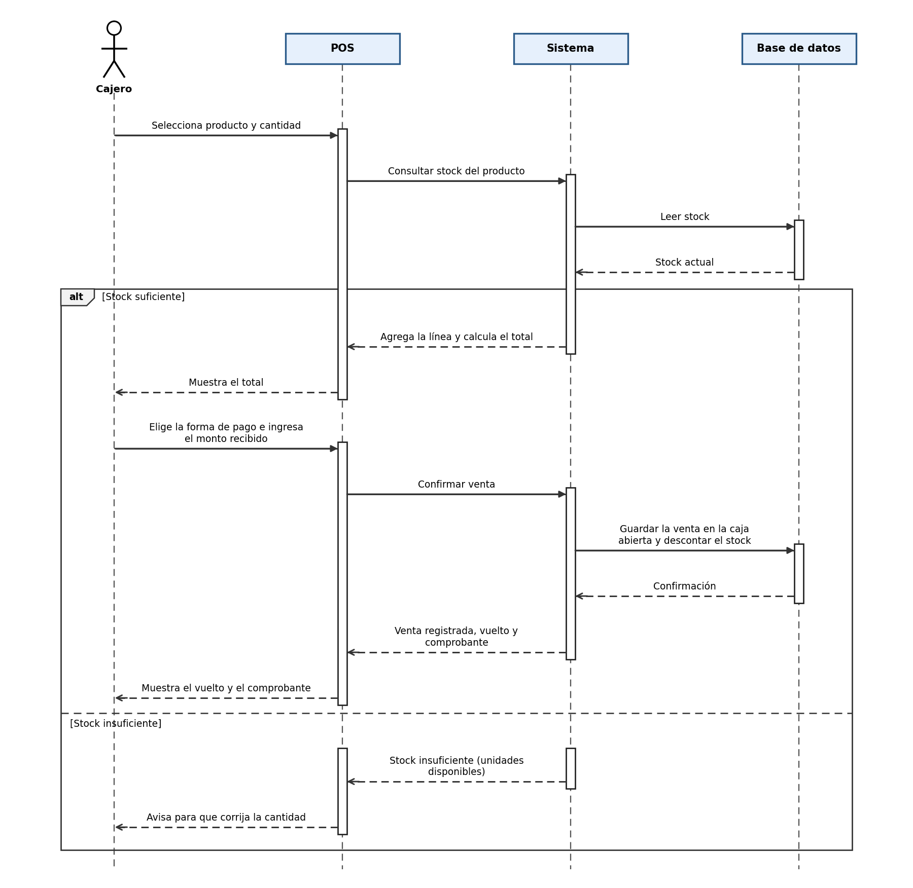

El Cajero carga los productos en el POS. El sistema consulta el stock antes de agregar cada línea; si alcanza, continúa hasta confirmar y guardar la venta con el descuento de stock en una sola operación, y si no alcanza, avisa al Cajero (flujo alternativo 3a).

### 5.2 Diagrama de actividad con calles · CU-04 Arquear y cerrar caja

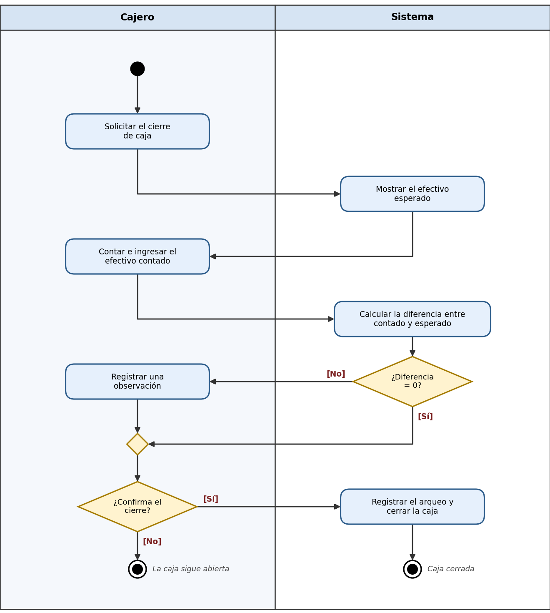

Las dos calles separan lo que hace el Cajero (solicitar el cierre, contar el efectivo, registrar la observación y confirmar) de lo que hace el Sistema (mostrar el efectivo esperado, calcular la diferencia y registrar el arqueo). Si la diferencia no es cero, el Cajero debe registrar una observación antes de confirmar; si no confirma, la caja sigue abierta (flujos alternativos 4a y 5a).

### 5.3 Diagrama de secuencia · CU-05 Registrar horneada

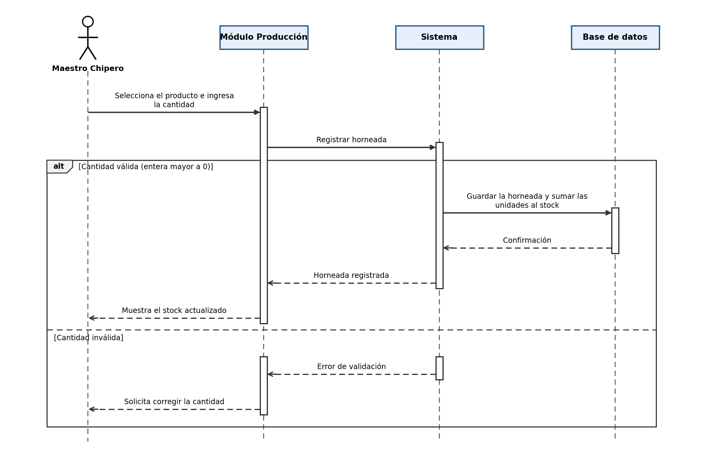

El Maestro Chipero informa lo que terminó de hornear; el sistema valida la cantidad y, si es correcta, guarda la horneada y actualiza el stock disponible para el mostrador.

### 5.4 Diagrama de actividad con calles · CU-07 Registrar devolución y rendición

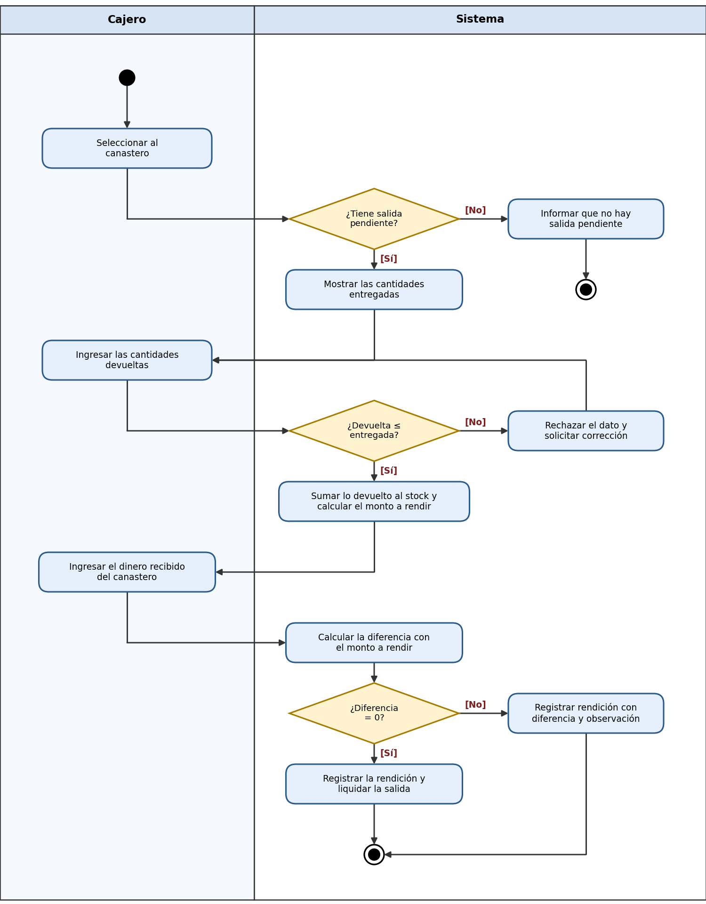

Muestra la liquidación del canastero al final de la jornada. El Cajero selecciona al canastero e ingresa lo devuelto y el dinero recibido; el Sistema verifica que haya una salida pendiente, valida las cantidades (RN-08), actualiza el stock, calcula el monto a rendir (RN-07) y registra la rendición, con una observación si la diferencia no es cero.

### 5.5 Diagrama de secuencia · CU-08 Registrar pedido con seña

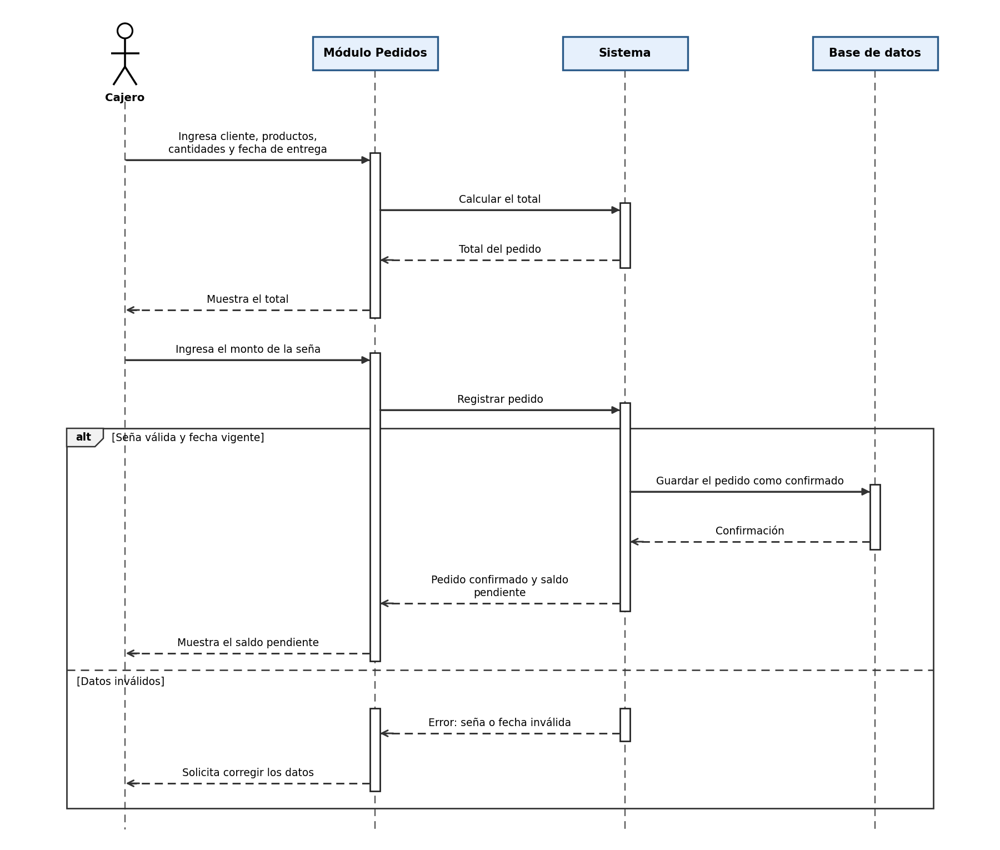

El sistema calcula el total del pedido y solo lo confirma si la seña y la fecha cumplen las reglas del negocio (RN-05 y RN-06).

---

## 6. Prototipo de interfaz (mockups)

> Prototipo de interfaz interactivo disponible [aqui](../prototipo-interfaz-interactiva/login.html)

**Pantalla — Inicio:**

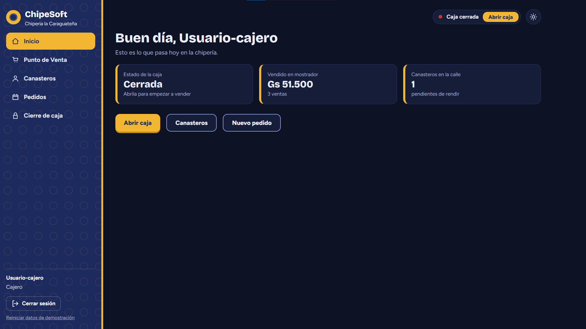
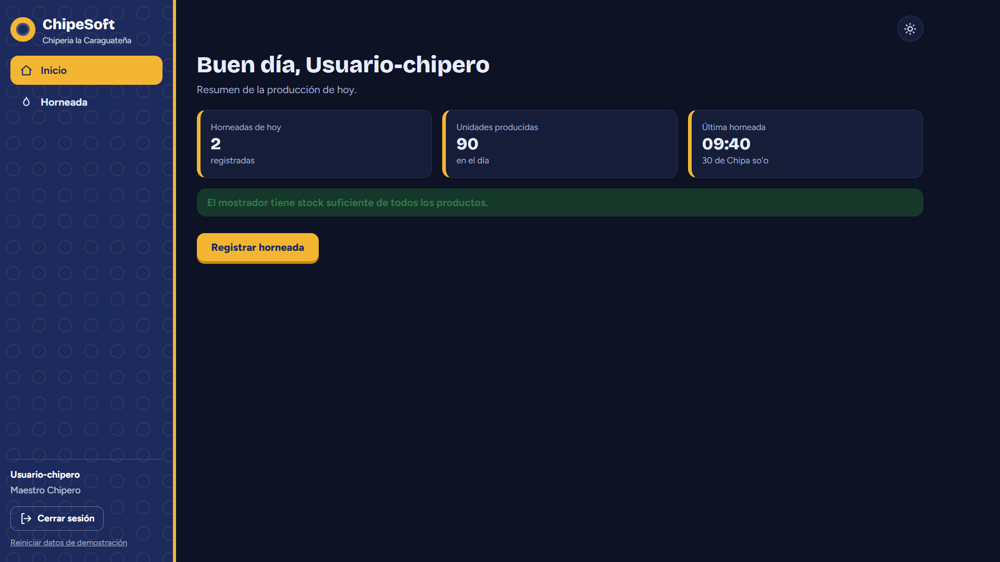

- **Caso de uso:** pantalla de apoyo a CU-01, que resume el estado del día según el rol (RF-01)
- **Actor:** Cajero, Maestro Chipero o Dueño
- **Datos:** Caja (estado, monto inicial), Venta (total del día), Producto (stock actual), Salida de Canastero
- **Interacción:** Tras iniciar sesión, el usuario ve un resumen con accesos directos a lo que más usa: el Cajero, el estado de la caja, los canasteros en la calle y los productos con poco stock; el Maestro Chipero, el resumen de la producción del día (horneadas, unidades producidas, última horneada y productos con poco stock); el Dueño, los ingresos del día y de la semana.

**Pantalla — Punto de venta (POS):**

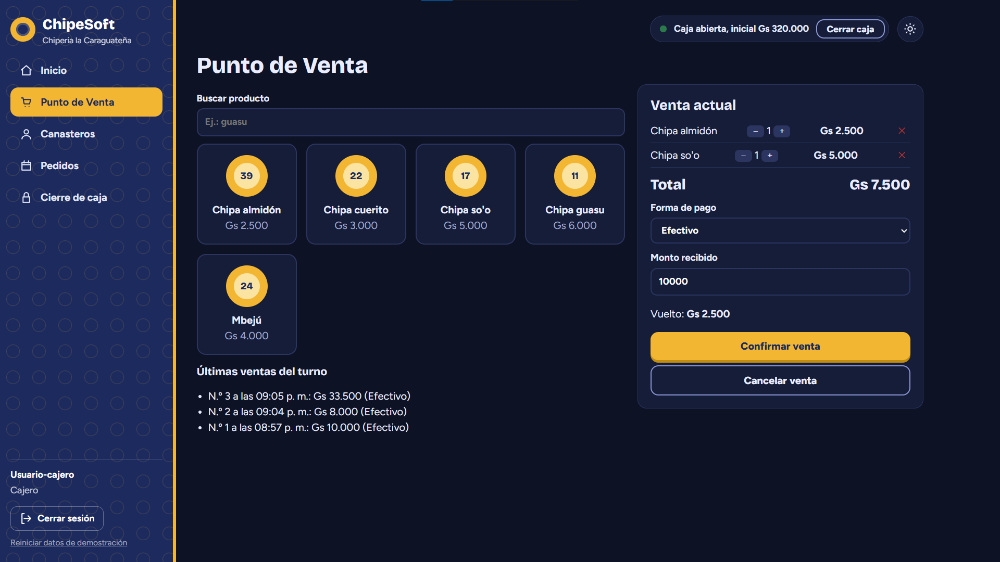

- **Caso de uso:** CU-03 Registrar venta (con CU-11 cuando el pago no es en efectivo)
- **Actor:** Cajero
- **Datos:** Producto (nombre, precio, stock actual), Venta (total, forma de pago, monto recibido, vuelto, referencia de pago), Detalle de Venta (cantidad, subtotal)
- **Interacción:** Con la caja abierta, el Cajero toca los productos para agregarlos y ajusta las cantidades. Elige la forma de pago: en efectivo ingresa el monto recibido y el sistema calcula el vuelto; con tarjeta o transferencia anota el número de comprobante. Al confirmar, el sistema descuenta el stock, suma el importe a la caja y muestra el comprobante interno. Con la caja cerrada la pantalla queda bloqueada con un aviso (RN-01), y no permite vender más unidades que el stock (RN-02).

**Pantalla — Canasteros:**

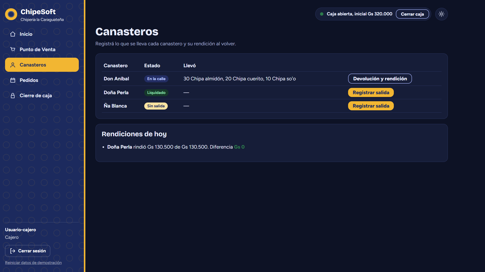

- **Casos de uso:** CU-06 Registrar salida de canastero y CU-07 Registrar devolución y rendición
- **Actor:** Cajero
- **Datos:** Canastero, Salida de Canastero (fecha, estado, monto a rendir, monto recibido, diferencia)
- **Interacción:** La pantalla lista a cada canastero con su estado (sin salida, en la calle o liquidado), lo que llevó y el botón de la acción que corresponde: "Registrar salida" si no tiene una salida pendiente, o "Devolución y rendición" si está en la calle (RN-12). Abajo se listan las rendiciones del día.

**Pantalla — Dialogo devolución y rendición:**

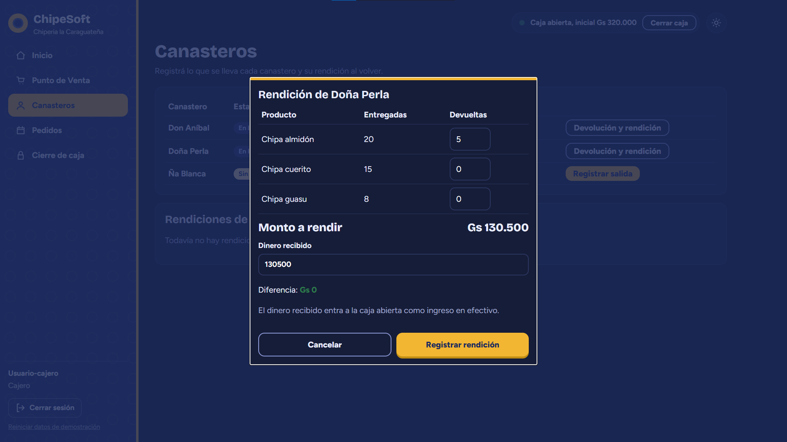

- **Caso de uso:** CU-07 Registrar devolución y rendición
- **Actor:** Cajero
- **Datos:** Salida de Canastero (monto a rendir, monto recibido, diferencia, estado), Detalle de Salida (cantidad entregada, cantidad devuelta), Caja
- **Interacción:** El Cajero ingresa las unidades devueltas de cada producto, sin superar lo entregado (RN-08); el monto a rendir se calcula automáticamente (RN-07). Luego ingresa el dinero recibido y el sistema muestra la diferencia, que exige una observación si no es cero. Al confirmar, las devoluciones vuelven al stock, el dinero entra a la caja abierta (RN-13) y la salida queda liquidada. Con la caja cerrada el botón está deshabilitado.

**Pantalla — Cierre de caja:**

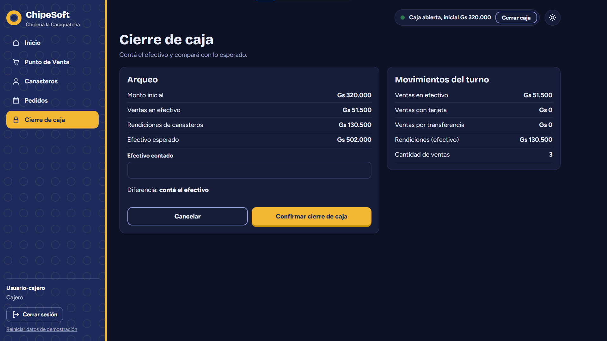

- **Caso de uso:** CU-04 Arquear y cerrar caja
- **Actor:** Cajero
- **Datos:** Caja (monto inicial, estado), Arqueo de Caja (efectivo esperado, efectivo contado, diferencia, observación), Venta (por forma de pago)
- **Interacción:** Desde el botón "Cerrar caja" de la barra superior, el sistema muestra el efectivo esperado (monto inicial, ventas en efectivo y rendiciones de canasteros) y los movimientos del turno. El Cajero ingresa el efectivo contado y ve la diferencia; si no es cero, debe escribir una observación (RN-09). Puede cancelar y volver al Punto de Venta, o confirmar el cierre en una ventana de confirmación; la caja cerrada ya no admite movimientos (RN-11) y queda el resumen con la opción de abrir una nueva caja.

**Pantalla — Horneada:**

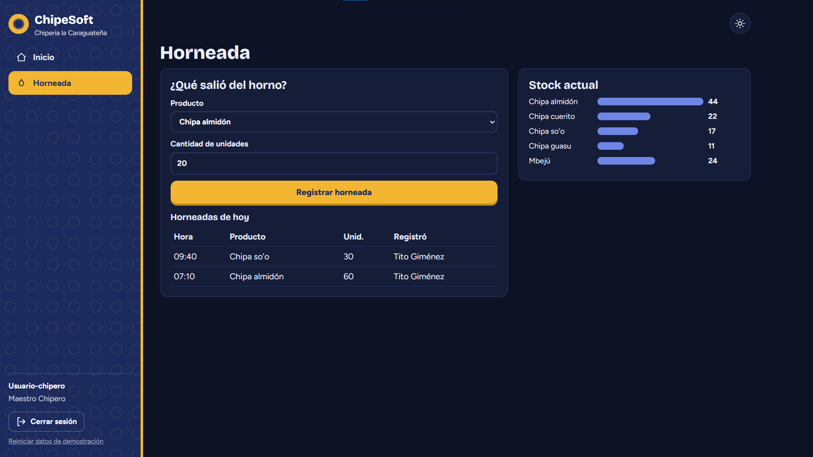

- **Caso de uso:** CU-05 Registrar horneada
- **Actor:** Maestro Chipero
- **Datos:** Horneada (fecha y hora, cantidad), Producto (stock actual), Usuario
- **Interacción:** El Maestro Chipero elige el producto e ingresa la cantidad que salió del horno. El sistema valida que sea un entero mayor a 0 (RN-10), suma las unidades al stock y agrega la horneada al historial del día con la hora y el usuario que la registró. El panel de stock marca en rojo los productos con poco stock.

**Pantalla — Reportes:**

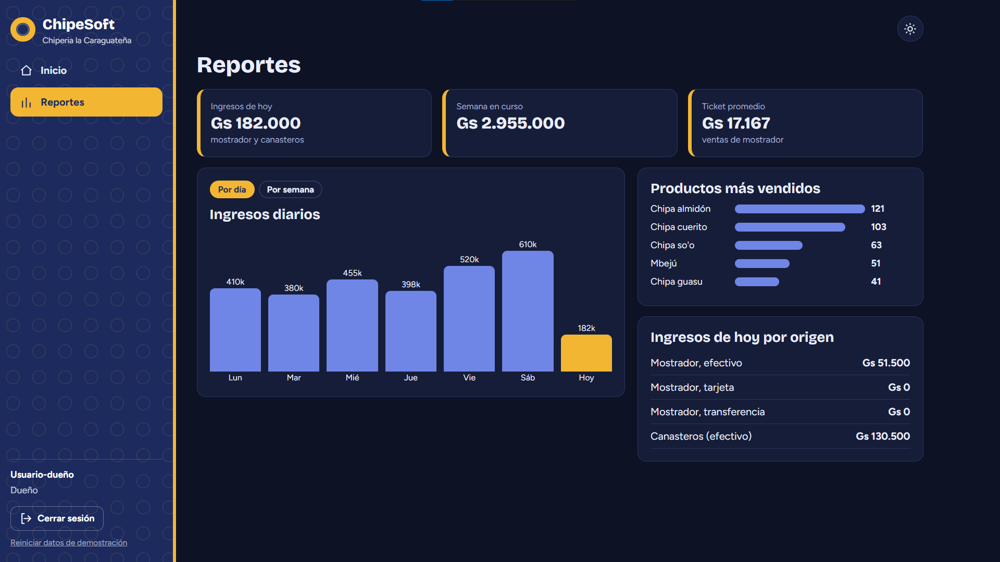

- **Caso de uso:** CU-09 Consultar reportes
- **Actor:** Dueño
- **Datos:** Venta (total, fecha y hora, forma de pago), Salida de Canastero (monto recibido), Producto (unidades vendidas)
- **Interacción:** El Dueño consulta los ingresos en un gráfico de barras que alterna entre vista diaria y semanal, junto con los ingresos de hoy (mostrador y canasteros), el ticket promedio, los productos más vendidos y los ingresos de hoy por origen.

---

## 7. Reglas del negocio

| ID | Regla |
|---|---|
| RN-01 | [ej. Un usuario no puede registrar dos reservas superpuestas] |
| RN-02 | [Regla 2] |

---

## 8. Matriz de trazabilidad

| Requisito | Caso(s) de uso relacionado(s) |
|---|---|
| RF-01 | CU-01 |
| RF-02 | CU-02, CU-03 |
| RF-03 | CU-01 |

---

[← Anterior: Conceptualización](conceptualizacion.md) · [Siguiente: Diseño →](diseno.md)
